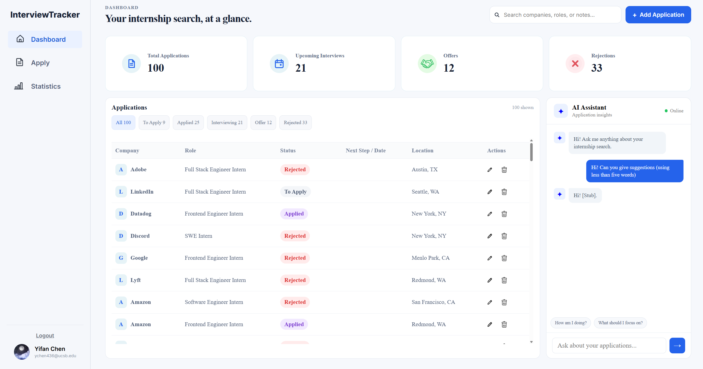
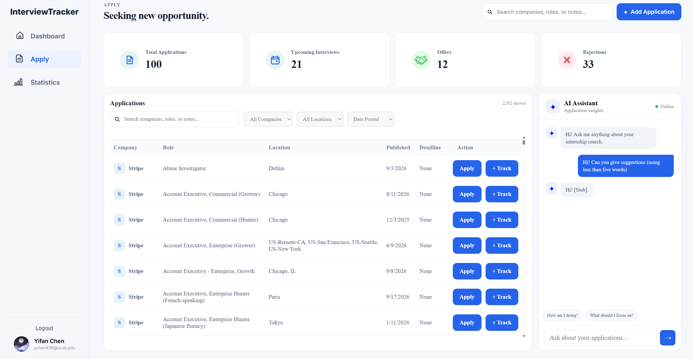
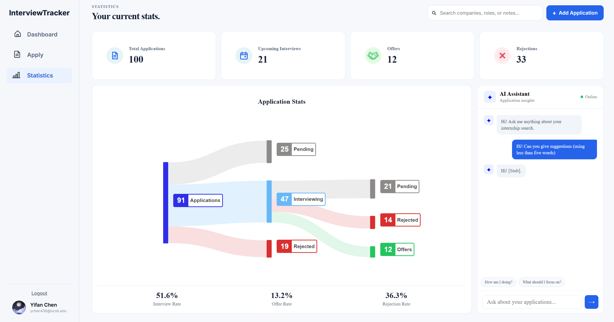

# Interview Tracker

Interview Tracker is a full-stack web application for discovering software engineering opportunities and managing job and internship applications in one place.

The application aggregates job postings from public job-board APIs and provides tools for searching and filtering available positions. Authenticated users can save opportunities, track their progress through the application pipeline, manage upcoming steps, visualize application outcomes, and receive AI-powered assistance based on their application data.

## Screenshots

### Application Dashboard



### Job Finder



### Statistics



## Features

- Sign in securely with Google OAuth
- Maintain user-specific application data across sessions
- Track applications through stages including To Apply, Applied, Interviewing, Offer, and Rejected
- Browse job openings aggregated from public job-board APIs
- Search and filter opportunities by company, location, and posting date
- View posting dates and application deadlines
- Open original job postings directly from the application
- Receive updates when new job postings are discovered
- Visualize application progression and outcomes using Sankey diagrams
- Receive AI-powered job search and application insights through an integrated chat interface

## Technology

The frontend is built with **React**, **TypeScript**, and **Vite**. **Axios** is used to communicate with the backend API, and **Recharts** is used for application data visualizations.

The backend is built with **Node.js** and **Express.js**. Application and job data are stored in **MongoDB** and accessed through **Mongoose**.

Job posting data is collected from public job-board APIs, including Greenhouse job boards.

## Project Structure

```text
Interview-tracker-project/
├── frontend/        # React and TypeScript frontend
├── backend/         # Node.js and Express backend
└── README.md
```

## Local Development

### Prerequisites

Before running the project, make sure you have:

- Node.js
- npm
- MongoDB or a MongoDB Atlas database

### Clone the repository

```bash
git clone <your-repository-url>
cd Interview-tracker-project
```

### Backend

Install the backend dependencies:

```bash
cd backend
npm install
```

Create a `.env` file inside the `backend` directory and add:

```env
MONGO_URI=your_mongodb_connection_string
GEMINI_API_KEY=your_google_ai_studio_api
```

The `.env` file contains credentials and should **not** be committed to Git.

Start the backend:

```bash
npm start
```

### Frontend

In a separate terminal, install the frontend dependencies:

```bash
cd frontend
npm install
```

Start the Vite development server:

```bash
npm run dev
```

Open the local URL displayed by Vite in your browser.

## How It Works

The backend collects job postings from public job-board APIs and stores the normalized job data in MongoDB. Express provides REST API endpoints that allow the React frontend to retrieve the stored jobs.

The frontend retrieves the available jobs when the job listings page loads. Search, filtering, and sorting can then be performed on the retrieved data without repeatedly requesting the same data from the backend.

```text
Public Job APIs
      ↓
Node.js / Express
      ↓
MongoDB
      ↓
REST API
      ↓
React / TypeScript
      ↓
Job Search & Application Tracker
```

## Future Development

Planned improvements include:

- Expanding job-source coverage
- Improving job search and filtering
- Deploying the full-stack application
- Improve current AI features

## Author

**YiFan Chen**
